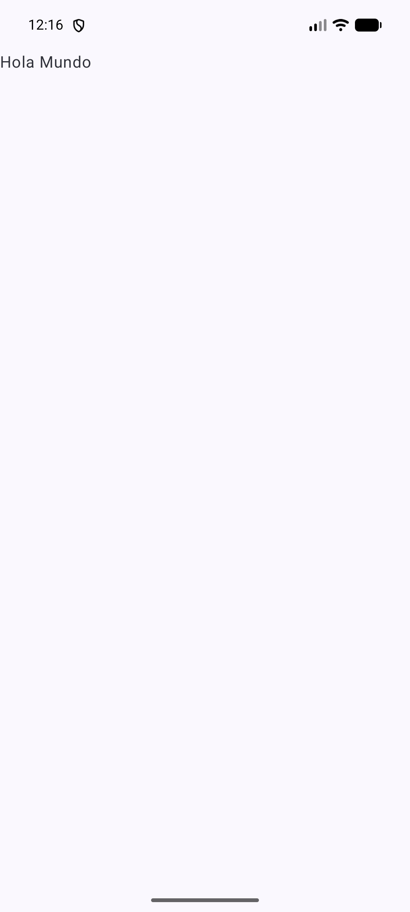

# 👋 Hola Mundo – Primera app Android con Jetpack Compose

> **Reto inicial del curso Desarrollo de Aplicaciones para Dispositivos Móviles**
> **Autor y desarrollador:** Luis Alberto Castillo Sanabria · Universidad Nacional de Colombia
> **Plataforma:** Android (Kotlin + Jetpack Compose)

Primera aplicación del curso. Es el punto de partida para conocer la estructura de un proyecto Android moderno: la `Activity` principal, las funciones `@Composable`, el tema de Material 3 y la vista previa de Android Studio.

  

## Funcionalidades

- Pantalla principal construida con **Jetpack Compose** que muestra el saludo *"Hola Mundo"*.
- Uso de `Scaffold` y `enableEdgeToEdge()` para aprovechar toda la pantalla.
- Tema propio (`HolaMundoTheme`) con colores y tipografía de Material 3.
- Vista previa (`@Preview`) para ver la interfaz sin instalar la app.
- Código comentado línea por línea con fines didácticos.

## Documentación

📘 **[Manual de usuario y técnico](docs/MANUAL.md)**: cómo usar la app, cómo está construida y cómo compilarla.

## Tecnologías

| Componente | Detalle |
|---|---|
| Lenguaje | Kotlin |
| Interfaz | Jetpack Compose + Material 3 |
| SDK mínimo | Android 7.0 (API 24) |
| SDK objetivo | API 37 |
| IDE | Android Studio |

## Cómo ejecutarlo

1. Clonar el repositorio: `git clone https://github.com/LCastillo9806/HolaMundo.git`
2. Abrirlo en **Android Studio** y esperar la sincronización de Gradle.
3. Ejecutarlo con **Run ▶** en un emulador o en un teléfono con la depuración USB activada.

## Autoría

Desarrollado por **Luis Alberto Castillo Sanabria** ([@LCastillo9806](https://github.com/LCastillo9806)) para el curso *Desarrollo de Aplicaciones para Dispositivos Móviles* de la **Universidad Nacional de Colombia**.
