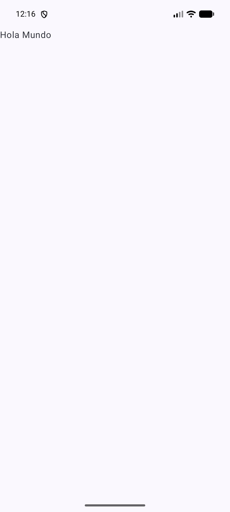

# 👋 Manual de Usuario y Técnico — Hola Mundo

> **Reto inicial del curso Desarrollo de Aplicaciones para Dispositivos Móviles**
> **Autor y desarrollador:** Luis Alberto Castillo Sanabria
> **Institución:** Universidad Nacional de Colombia
> **Plataforma:** Android · Kotlin · Jetpack Compose

---

## 📑 Tabla de contenidos

1. [Propósito](#1-propósito)
2. [Autoría](#2-autoría)
3. [Manual de uso](#3-manual-de-uso)
4. [Cómo está construida](#4-cómo-está-construida)
5. [Compilación y ejecución](#5-compilación-y-ejecución)

---

## 1. Propósito

**Hola Mundo** es la primera aplicación del curso. Su objetivo no es la funcionalidad sino el aprendizaje: crear un proyecto desde cero en Android Studio, entender qué archivos genera, cómo arranca una app y cómo se dibuja una interfaz con **Jetpack Compose**, el sistema declarativo de interfaces de Android.

## 2. Autoría

| Integrante | Rol |
|:---|:---|
| **Luis Alberto Castillo Sanabria** | Autor y desarrollador |

Curso *Desarrollo de Aplicaciones para Dispositivos Móviles* — **Universidad Nacional de Colombia**.
Repositorio: <https://github.com/LCastillo9806/HolaMundo>

## 3. Manual de uso

1. Abre la app **HolaMundo** desde el cajón de aplicaciones.
2. La pantalla principal muestra el texto **"Hola Mundo"** en la parte superior.

| Pantalla principal |
|:---:|
|  |

La app ocupa toda la pantalla (*edge-to-edge*) y el `Scaffold` se encarga de que el texto no quede debajo de la barra de estado.

## 4. Cómo está construida

### 4.1 Estructura del proyecto

| Archivo | Función |
|---|---|
| `app/src/main/java/com/example/holamundo/MainActivity.kt` | Punto de entrada de la app y componentes de la interfaz |
| `app/src/main/java/com/example/holamundo/ui/theme/Color.kt` | Paleta de colores |
| `app/src/main/java/com/example/holamundo/ui/theme/Theme.kt` | Tema `HolaMundoTheme` (claro/oscuro, Material 3) |
| `app/src/main/java/com/example/holamundo/ui/theme/Type.kt` | Tipografía |
| `app/src/main/AndroidManifest.xml` | Declara la actividad principal y el ícono |
| `app/build.gradle.kts` | Configuración de compilación y dependencias |

### 4.2 Flujo de arranque

```
Android abre la app
   └─ MainActivity.onCreate()
        ├─ enableEdgeToEdge()        → usa toda la pantalla
        └─ setContent { ... }        → dibuja la interfaz con Compose
             └─ HolaMundoTheme
                  └─ Scaffold
                       └─ Greeting()  → Text("Hola Mundo")
```

### 4.3 Código principal

```kotlin
class MainActivity : ComponentActivity() {
    override fun onCreate(savedInstanceState: Bundle?) {
        super.onCreate(savedInstanceState)
        enableEdgeToEdge()
        setContent {
            HolaMundoTheme {
                Scaffold(modifier = Modifier.fillMaxSize()) { innerPadding ->
                    Greeting(name = "Android", modifier = Modifier.padding(innerPadding))
                }
            }
        }
    }
}

@Composable
fun Greeting(name: String, modifier: Modifier = Modifier) {
    Text(text = "Hola Mundo", modifier = modifier)
}
```

- **`@Composable`** marca una función que genera interfaz.
- **`Scaffold`** da la estructura base de la pantalla y entrega el `innerPadding` para respetar las barras del sistema.
- **`@Preview`** (en `GreetingPreview`) permite ver el resultado en Android Studio sin instalar la app.

## 5. Compilación y ejecución

**Requisitos:** Android Studio reciente con el SDK de Android y un emulador o teléfono con Android 7.0 o superior.

```bash
git clone https://github.com/LCastillo9806/HolaMundo.git
cd HolaMundo
./gradlew assembleDebug          # genera app/build/outputs/apk/debug/app-debug.apk
./gradlew installDebug           # instala en el dispositivo conectado
```

También se puede abrir el proyecto en Android Studio y pulsar **Run ▶**.

---
*Luis Alberto Castillo Sanabria — Universidad Nacional de Colombia*
